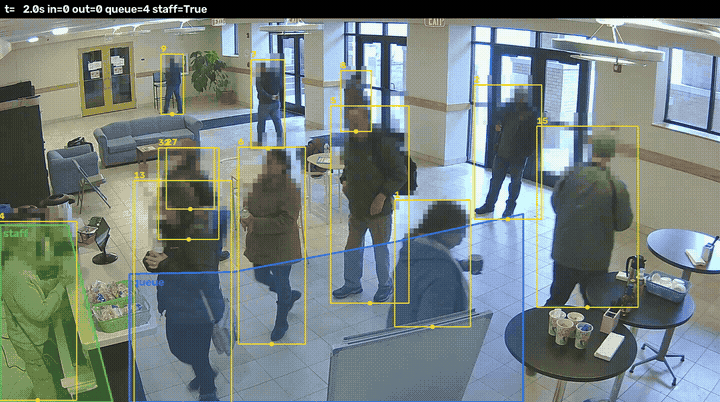
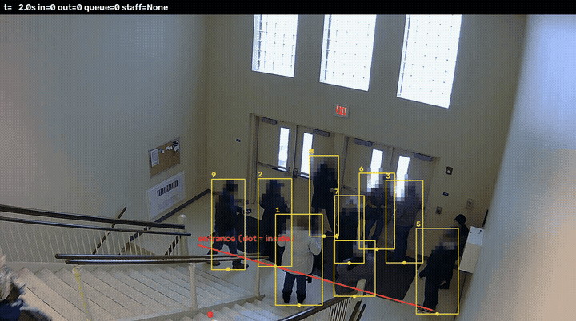
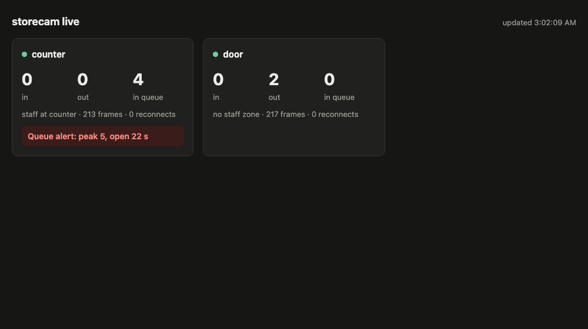

# storecam

Store camera analytics: people counting at a door, queue and counter monitoring, and alerts, over several video streams at once.

Work in progress for the Safia AI team case study (deadline 2026-11-12); the repository is pushed as the work goes so its history shows the process.

Status, 2026-11-11: the service, door counting, zones, alerts, multi-stream reconnect, the Docker setup and the evaluation are working and measured (results below), plus the bonuses: batched inference, staff versus customer, an ONNX Runtime export and a live page; Shokhbek's review of Claude's queue labels is still to come.
The full report, including the process and who did what, is `REPORT.md`; the options considered for every choice are in `docs/DECISIONS.md`, and every test run is in `docs/EXPERIMENTS.md`.

Built with Claude Code as an AI coding assistant; the brief allows AI tools.

## What it looks like

Counter (left: staff zone in green, queue zone in blue) and entrance (red line: door line, the dot marks the inside); 12 s of each at 5 frames per second, from `storecam run --save-video`.
Faces are pixelated by the service itself (top 30% of each person box, D10); a person the detector misses in a frame is not pixelated in that frame.
People the service judges to be staff are drawn in green (D14).




The live page (`--http`), refreshed every second (D16):



## Setup

```sh
uv sync
./scripts/download.sh   # videos and weights, about 620 MB, checked by SHA-256; the MEVA bucket is slow (about 50 min here), and the script resumes after a dropped connection
```

## Run

```sh
uv run storecam run                  # every source in config.yaml at real-time speed
uv run storecam run --offline        # every sampled frame, as fast as possible (evaluation)
uv run storecam run --http 8765      # also serve a live page at http://127.0.0.1:8765/ (JSON at /status.json)
uv run storecam run --save-video     # also write annotated video with faces pixelated
uv run storecam run --url counter=rtsp://127.0.0.1:8554/counter   # swap a source's address, keep its zones
uv run pytest                        # unit tests for counting, zones, alerts, staff and the live endpoint
```

Outputs go to `runs/out/`: `<source>_minutes.csv` per source, `alerts.jsonl`, and `run_summary.json` with speeds.

## Reproduce the measurements

```sh
uv run python scripts/evaluate.py --rerun     # runs every clip offline, compares with labels/, writes results/eval/report.json
uv run python scripts/benchmark.py            # speed: 2 streams in real time, then 1, 2 and 4 streams on GPU and CPU
uv run python scripts/calibrate_staff.py counter data/meva/counter_1650.avi   # the staff uniform colour in config.yaml
uv run --group export python scripts/export_onnx.py && uv run python scripts/compare_detectors.py   # ONNX Runtime against PyTorch (E15)
```

Without `--rerun`, `evaluate.py` reuses the run summaries already in `results/eval/` and only recomputes the comparison.
Offline runs are deterministic on one machine, so the report comes out identical (E13).

## Run with Docker

```sh
./scripts/download.sh          # the clips and weights are mounted, not baked into the image
docker compose up --build
```

This starts two RTSP cameras (MediaMTX looping two clips) and the service reading both, writing to `runs/docker/`, with the live page at http://127.0.0.1:8080/ (JSON at /status.json).
Every port is bound to 127.0.0.1.
Docker on macOS cannot use the Apple GPU, so here the detector runs on CPU at about 5 FPS per stream, half the target; the native run above uses the GPU (E12, D13).
Stop the camera container (`docker compose stop cameras`, then `start`) to watch the service reconnect.

## Run with ONNX Runtime (bonus)

```sh
uv run --group export python scripts/export_onnx.py   # writes models/yolo26s_dynamic.onnx and models/yolo26s_384x640_b2.onnx
```

Then set `model.weights` in `config.yaml` to one of them; nothing else changes.
On a Mac the fixed-size export runs on the GPU through CoreML (as FP32), elsewhere on CPU; on all five clips it gave exactly the PyTorch results (E15, D15).

## Results

Measured on the MEVA clips below against hand labels; full tables, method and failure cases with timestamps are in `REPORT.md` sections 5 and 6.

| What | Result |
|---|---|
| Door, arrival clip, hand vs system IN/OUT | 22/3 vs 21/4 (19 of 25 events matched within 2 s) |
| Door, departure clip, hand vs system IN/OUT | 0/13 vs 0/11 (5 of 13 events matched within 2 s) |
| Queue length MAE at 10 s marks | 1.00 (Shokhbek, 11 marks); 0.37, 0.17, 0.00 (Claude, 30 marks on each of 3 clips) |
| Queue alerts | 3 of 3 expected found (two merged into one), 0 wrong; the last wrong one, a seated man on the zone's edge, was removed by redrawing that edge, chosen on the same clips (E16) |
| Staff versus customer (bonus) | uniform colour plus time behind the counter; left the attendant out of the queue when they walked through it, with one 1 s mistake after an ID switch (E14) |
| ONNX Runtime export (bonus) | identical results to PyTorch on all five clips; detector 15.6 ms against 17.8 ms per pair of frames on the Mac GPU, and about 3.4 times faster than PyTorch on CPU in Docker, both from single runs on a machine that was not quiet (E15); the full benchmark is still to be repeated |
| Empty-counter alerts | none expected, 0 wrong with the staff rule (1 wrong without it) |
| Speed, Apple M4 Pro GPU (MPS), YOLO26s 640 px FP32, 1164 MB GPU memory | 2 streams in real time: 9.87 FPS each against a 10 FPS target; as fast as possible: 97 / 119 / 131 FPS total for 1 / 2 / 4 streams; CPU only: 23 / 24 / 28 |

## Known failure cases

Times are positions in the clip; the full list with causes is `REPORT.md` section 6.

- **Attendant lost at the edge of the counter view** (`counter_1650` 0:09 to 0:14, 1:06 to 1:09, 4:28 to 4:35; `counter_1720` 1:04, 2:29): the staff zone reads empty, so the per-minute "empty counter seconds" overstate; the 10 s alert delay absorbs it.
- **Staff counted as a customer after an ID switch** (`counter_1735` 2:35 to 2:45, and a customer left out for 1 s at 4:34): the staff rule only holds while the tracker keeps one ID per person (E14).
- **People on the queue zone's edges** (`counter_1650` 4:10 to 4:48): a seated man on the edge raised a wrong queue alert until the edge was moved in front of the chairs (E16); chairs move, so zones need checking when furniture does.
- **Departures in a crowd** (`door_0307_1720`): people who waited on the mats were counted 30 to 40 s early (0:03, 0:04, 0:13), and of a group leaving at 0:42 to 0:54 fewer were counted, and earlier, as the tracker lost them in the doorway (E9).
- **Flip-flops at the door line** (track 216 at 4:45.7, track 19 at 0:40.9 to 0:43.2): a partly hidden box moves the foot point across the line; the 40 px band and 4-frame confirmation remove most, not all.
- **A whiteboard hides lower bodies** in the counter view, so foot points sit too high, and **stair traffic** at the left end of the door line can be counted as door traffic.

## Scaling to about 50 cameras

A plan, not a measurement (no NVIDIA GPU here); details and sources in `REPORT.md` section 7.

- 50 cameras at 10 analysed fps is 500 detections per second; the event logic is cheap, decoding and detection are not.
- Decoding breaks first, since every frame must be decoded even when a third are analysed: use each camera's secondary stream (720p or lower, 10 to 15 fps) and decode on the GPU (NVDEC through DeepStream or GStreamer) so frames stay on the GPU.
- Inference: a TensorRT FP16 engine (or ONNX Runtime with its TensorRT provider, D15), fixed batches of 16 to 32 from the newest frame of every camera, as the service already batches (D5).
- The CPU side: a few worker processes of about a dozen cameras each, rather than one Python process with 50 threads, with resizing on the GPU.
- Counter-only cameras need about 2 fps, since zones are summarised per second, which frees capacity for door cameras.
- Operations: per-camera health (fps, reconnects, last frame time) and an alert on a dead camera; the service already drops frames rather than letting one slow camera back up the others.

## Footage

All footage comes from the MEVA dataset (Multiview Extended Video with Activities), recorded by Kitware, Inc. for the IARPA DIVA programme.
The people in it are actors following a script, filmed at a training facility.

- Licence: Creative Commons Attribution 4.0 International (CC BY 4.0), https://creativecommons.org/licenses/by/4.0/
- Dataset page: https://mevadata.org
- Annotations and metadata: https://gitlab.kitware.com/meva/meva-data-repo

| Local file | Camera | Source URL | Timestamps used |
|---|---|---|---|
| `counter_1650.avi` | school.G421, lobby counter | https://mevadata-public-01.s3.amazonaws.com/drops-123-r13/2018-03-07/16/2018-03-07.16-50-00.16-55-00.school.G421.r13.avi | 00:00 to 05:00 (whole clip) |
| `counter_1720.avi` | school.G421, lobby counter | https://mevadata-public-01.s3.amazonaws.com/drops-123-r13/2018-03-07/17/2018-03-07.17-20-00.17-25-00.school.G421.r13.avi | 00:00 to 05:00 (whole clip) |
| `counter_1735.avi` | school.G421, lobby counter | https://mevadata-public-01.s3.amazonaws.com/drops-123-r13/2018-03-07/17/2018-03-07.17-35-00.17-40-00.school.G421.r13.avi | 00:00 to 05:00 (whole clip) |
| `door_0309_1010.avi` | school.G420, entrance | https://mevadata-public-01.s3.amazonaws.com/drops-123-r13/2018-03-09/10/2018-03-09.10-10-01.10-15-01.school.G420.r13.avi | 00:00 to 05:00 (whole clip) |
| `door_0307_1720.avi` | school.G420, entrance | https://mevadata-public-01.s3.amazonaws.com/drops-123-r13/2018-03-07/17/2018-03-07.17-20-01.17-25-01.school.G420.r13.avi | 00:00 to 05:00 (whole clip) |

Author: Kitware, Inc. and the IARPA DIVA programme (MEVA dataset).
Why these clips and not others: `docs/DECISIONS.md`, D1.
